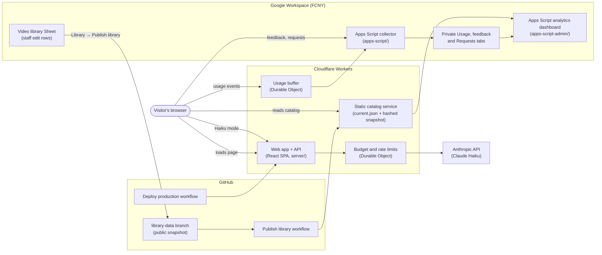

# AI Sprint Video Recommender

Describe what you want to do with AI and get a short list of videos from the AI for Nonprofits Sprint's video library, each with a reason it fits.

[](https://github.com/pursuit-capstone-fcny/ai-sprint-recommender/actions/workflows/deploy.yml)

**Live site:** https://ai-sprint-recommender.jason-zeng151.workers.dev/

Built for the AI for Nonprofits Sprint at the Fund for the City of New York (FCNY) by Team AJ3, as part of Pursuit's AI-Native Program.

## Contents

- [Overview](#overview)
- [Features](#features)
- [How recommendations work](#how-recommendations-work)
- [Architecture](#architecture)
- [Tech stack](#tech-stack)
- [Repository structure](#repository-structure)
- [Getting started](#getting-started)
- [Configuration and production switches](#configuration-and-production-switches)
- [Deployment](#deployment)
- [Maintaining the video library](#maintaining-the-video-library)
- [Analytics and privacy](#analytics-and-privacy)
- [Costs and limits](#costs-and-limits)
- [Quality](#quality)
- [Known limitations and roadmap](#known-limitations-and-roadmap)
- [Handoff](#handoff)
- [Contributing](#contributing)
- [Credits](#credits)
- [License](#license)

## Overview

The AI for Nonprofits Sprint has recorded about 90 short videos of nonprofit staff using AI tools for real work: grant reports, spreadsheets, slide decks, feedback analysis and more. With that many videos, people often don't know where to start.

This tool asks one question: _What would you like to do with AI?_ A visitor types a goal in their own words, and the page returns up to eight videos from the library with a short reason for each. There is no login. The video list comes from the Sprint's own Google Sheet, so staff keep it current without changing code.

## Features

### For visitors

| Feature                   | What it does                                                                                                     |
| ------------------------- | ---------------------------------------------------------------------------------------------------------------- |
| Free-text goal            | One text box (up to 500 characters). Enter searches; Shift+Enter adds a line.                                    |
| Up to 8 recommendations   | Each card shows the title, description, tool or topic tag, and a **Why this video** reason.                      |
| Never an empty page       | A curated starter set appears before any search. If nothing matches, a labelled set of fallback videos is shown. |
| Two ways to watch         | Play the video inside the page, or open it with **Watch on YouTube**.                                            |
| Copy link                 | Copies the video's YouTube link to share.                                                                        |
| "Was this helpful?"       | An optional, private Helpful / Not helpful vote on each recommendation.                                          |
| Request a video or a demo | A short form to suggest a missing topic or offer to record a demo. Staff review submissions.                     |
| Engine choice             | A toggle between **Haiku AI** (the default) and **Deterministic** (the rules engine).                            |

### For FCNY staff: analytics dashboard

A private dashboard, hosted on Google Apps Script, shows how the library is used. It requires a Google sign-in and loads the library Sheet configured for the site automatically; staff need Google access to that Restricted Sheet. A footer link on the site opens it.

- **Videos:** how often each video appeared in results and was played in the page or opened on YouTube. This helps find unused content.
- **Tags & keywords:** how often each tool, task and function-area tag appeared.
- **Keyword associations:** which tags led to which videos.
- **Topic search:** staff can search the library by topic.
- **Filters:** date range, traffic source, mode, and an **Include team traffic** checkbox.
- **Export:** **Download CSV** and **Copy as CSV** export exactly the rows and columns on screen. The file name includes the date range.

Appearances and clicks are counted only from searches that produced real matches. Curated fallback cards are left out, so the numbers reflect what visitors actually found. Counts are appearances and clicks, not completed watches.

## How recommendations work

**Rules engine ("Deterministic").** This runs entirely in the visitor's browser with no AI calls. It reads the visitor's goal and matches its words against the tags staff reviewed in the Sheet: tools (such as Copilot, Claude or NotebookLM), tasks (such as spreadsheet formulas or slide decks) and function areas. Strong matches are ranked, duplicates are removed, and up to eight are shown. The results are repeatable: the same goal and the same library always give the same videos. The logic lives in `src/engine/` and `src/recommendations/deterministicSelection.ts`.

**Haiku AI mode (the default).** The site's server sends the visitor's goal and the public video metadata to Anthropic's Claude Haiku model in a single request. The model picks relevant videos and writes a reason for each. Every answer is checked against the published catalog before display, so the model can only return real Sprint videos. Calls are limited by daily and monthly spending caps and rate limits (see [Costs and limits](#costs-and-limits)). The page tells visitors that their goal is sent to Anthropic. When the site is busy, requests wait in a queue.

**Curated defaults and fallbacks.** Staff curated two sets of eight videos in `src/recommendations/curatedVideos.ts`:

- **Starter set:** shown before anyone searches.
- **Fallback set:** shown, and labelled as such, when a search finds nothing or the AI service is unavailable. Fallback cards are never presented as AI picks.

Results are capped at eight (`MAX_RECOMMENDATIONS` in `src/recommendations/resultPolicy.ts`).

## Architecture



1. **Library.** Staff maintain the video list in a Google Sheet. When they choose **Publish library**, Apps Script validates the public columns, writes an immutable snapshot to the `library-data` branch, and starts the **Publish library** workflow.
2. **Static catalog.** The workflow deploys the snapshot as static JSON on a separate Cloudflare Worker. A `current.json` manifest points to a content-hashed file. Failed publishes leave the previous catalog live.
3. **Web app.** The React app and a small API run on a separate Cloudflare Worker. The rules engine runs in the browser.
4. **Haiku proxy.** In Haiku mode the browser calls the app's API. Before calling Anthropic, the server checks the spending caps and rate limits held in a Durable Object. The API key never reaches the browser.
5. **Usage.** Anonymous usage events are batched through a buffer Durable Object and forwarded to an Apps Script collector, which writes them to a private `Usage` tab in the library workbook. Feedback and requests go to the collector directly; requests are stored in a `Requests` tab in the same Restricted workbook.
6. **Analytics.** The Apps Script dashboard reads the private usage data, joins it with the published catalog, and shows aggregate counts to authorized staff.

Design decisions are recorded in [`docs/adr/`](docs/adr/). The publishing design is described in [`docs/analytics/library-publishing.md`](docs/analytics/library-publishing.md).

## Tech stack

| Layer                 | Technology                                                     |
| --------------------- | -------------------------------------------------------------- |
| Front end             | React 19, TypeScript, React Router (library mode), Vite        |
| Validation            | Zod                                                            |
| Hosting and API       | Cloudflare Workers (static assets, Durable Objects), Wrangler  |
| AI                    | Anthropic API, Claude Haiku (`claude-haiku-5-5`)               |
| Library and analytics | Google Sheets, Google Apps Script                              |
| Testing               | Vitest, Testing Library, jsdom                                 |
| Code quality          | ESLint (with jsx-a11y), Prettier, Husky, lint-staged, gitleaks |
| CI/CD                 | GitHub Actions                                                 |

Exact versions are in `package.json` and `pnpm-lock.yaml`.

## Repository structure

| Path                        | What lives there                                                                        |
| --------------------------- | --------------------------------------------------------------------------------------- |
| `src/pages/`                | The visitor page: goal form, results, cards                                             |
| `src/engine/`               | Rules-engine matching and ranking. Pure functions, no React or network                  |
| `src/recommendations/`      | Result selection, curated starter and fallback sets, Haiku request handling             |
| `src/contracts/`            | Shared types and Zod schemas: catalog, usage events, requests                           |
| `src/data/`, `src/library/` | Loading and validating the published catalog                                            |
| `src/usage/`                | Anonymous usage events and the `?src=` traffic tag                                      |
| `src/feedback/`             | "Was this helpful?" controls                                                            |
| `src/requests/`             | "Request a video or offer a demo" form                                                  |
| `src/analytics/`            | Report logic shared with the dashboard                                                  |
| `src/admin/`                | The analytics dashboard's interface (built into the Apps Script dashboard)              |
| `src/evaluation/`           | Relevance benchmarks for displayed results                                              |
| `server/`                   | Cloudflare Worker API: Haiku proxy, budget and rate limits, usage buffer, catalog route |
| `library/`                  | Configuration for the static catalog Worker                                             |
| `apps-script/`              | Apps Script for the library Sheet: publisher, usage collector, feedback and requests    |
| `apps-script-admin/`        | Apps Script for the private analytics dashboard                                         |
| `scripts/`                  | Build, configuration and check scripts used locally and in CI                           |
| `fixtures/`                 | Fictional test data. Contains no real FCNY data                                         |
| `docs/specs/`, `specs/`     | Feature specs with acceptance criteria                                                  |
| `docs/adr/`                 | Architecture decision records                                                           |
| `docs/analytics/`           | Publishing, maintenance, capacity, cost and deployment notes                            |
| `.github/workflows/`        | CI, PR previews, production deploy, library publishing, main-branch audit               |

[`AGENTS.md`](AGENTS.md) holds working rules for humans and coding agents. [`docs/glossary.md`](docs/glossary.md) defines canonical terms.

## Getting started

### Prerequisites

- **Node.js 24** (pinned in `.nvmrc`; `package.json` requires `>=24`)
- **pnpm 12.9.1** (pinned in `packageManager`)
- **gitleaks**, for the pre-commit secret scan (`brew install gitleaks` on macOS)

### Install and run

```sh
pnpm install
cp .env.example .env.local
pnpm dev
```

`.env.example` lists every front-end variable, with all optional features off by default. To load a catalog, set `VITE_LIBRARY_ORIGIN` to a published catalog origin. No Google credentials or API keys belong in front-end configuration.

### Commands

| Task                                          | Command                   |
| --------------------------------------------- | ------------------------- |
| Dev server                                    | `pnpm dev`                |
| Run tests once                                | `pnpm test`               |
| Typecheck                                     | `pnpm typecheck`          |
| Lint                                          | `pnpm lint`               |
| Check formatting                              | `pnpm format:check`       |
| Fix formatting                                | `pnpm format`             |
| Full build (app and both Apps Script bundles) | `pnpm build`              |
| Build the dashboard only                      | `pnpm build:admin`        |
| Validate a catalog                            | `pnpm check:catalog`      |
| Evaluate displayed results                    | `pnpm evaluate:displayed` |

## Configuration and production switches

Production behavior is controlled by GitHub repository variables, which `.github/workflows/deploy.yml` reads at build time. Changing one takes effect on the next production deploy (merge to `main`, or run **Deploy production** by hand).

| Repository variable               | Controls                                                                                                   |
| --------------------------------- | ---------------------------------------------------------------------------------------------------------- |
| `LLM_PRODUCTION_ENABLED`          | **AI kill switch.** `true` enables Haiku mode in the browser and on the server. Anything else turns it off |
| `USAGE_PRODUCTION_ENABLED`        | Anonymous usage logging                                                                                    |
| `USAGE_BUFFER_PRODUCTION_ENABLED` | Sending usage events through the server-side buffer instead of directly to the collector                   |
| `FEEDBACK_PRODUCTION_ENABLED`     | The "Was this helpful?" vote                                                                               |
| `FEEDBACK_QUESTION`               | The wording of the feedback question                                                                       |
| `REQUESTS_PRODUCTION_ENABLED`     | The "Request a video or offer a demo" form                                                                 |
| `REQUESTS_CONFIG`                 | The form's policy: endpoint, owner, retention and wording                                                  |
| `LIBRARY_PRODUCTION_ORIGIN`       | Which published catalog the site reads (required)                                                          |
| `CATALOG_PRODUCTION_URL`          | The Apps Script collector that receives usage, feedback and requests                                       |

The production catalog source is always the published static catalog (`VITE_CATALOG_SOURCE=static`).

Secrets are stored as GitHub Actions secrets and are never committed: `ANTHROPIC_API_KEY`, `CLOUDFLARE_API_TOKEN`, `CLOUDFLARE_ACCOUNT_ID` and `USAGE_BATCH_SECRET`.

**To turn a feature off:** set its variable to `false` and run **Deploy production**. Budget storage and collector cleanup keep running.

PR previews use separate test variables (`LIBRARY_TEST_ORIGIN`, `CATALOG_TEST_URL`, `FEEDBACK_PREVIEW_ENABLED`, `REQUESTS_PREVIEW_ENABLED`). PR previews never make paid AI calls.

## Deployment

### Website

- **Production.** `.github/workflows/deploy.yml` runs on every push to `main` and can be run by hand. It builds the app, generates the Worker configuration with `scripts/configure-library-app.mjs`, sets server secrets, and deploys to Cloudflare Workers.
- **PR previews.** `.github/workflows/preview.yml` deploys each pull request to an isolated preview with AI calls disabled.

### Video library

Staff publish from the Sheet's **Library → Publish library** menu. This dispatches `.github/workflows/publish-library.yml`, which validates the snapshot and deploys the static catalog Worker. Publishing is separate from code deployment and cannot change application code. There are separate `test` and `production` targets.

### Analytics dashboard (manual)

The dashboard is deployed by hand in the Apps Script editor:

1. Run `pnpm build:admin`.
2. Paste the files from `build/apps-script-admin/` into the dashboard's Apps Script project.
3. Choose **Deploy → Manage deployments**, select the existing deployment, choose **Edit**, set **Version** to **New version**, and deploy.

Always edit the existing deployment. Never choose **New deployment**, which creates a new URL and breaks the site's footer link and staff bookmarks.

The library publisher and usage collector (`apps-script/`, built by `pnpm build:apps-script`) are also deployed by hand. See [`apps-script/README.md`](apps-script/README.md) and [`apps-script/usage-README.md`](apps-script/usage-README.md).

## Maintaining the video library

Status: documented; production switch-over pending.

Staff maintain videos in the Video Tracker workbook. No code changes are needed.

1. **Add** a row with the title, description, YouTube link, categories, tool and status.
2. **Tag** it: fill **Task keywords** (comma-separated) and **Instruction format**, then set **Metadata status** to `Ready`.
3. **Publish:** choose **Library → Publish library → Review changes**, check the additions, edits and retirements, then choose **Publish library**. Use **Check status** until it reports success.
4. **Retire** a video by changing its Status away from the live YouTube statuses, then review and publish.

The full guide is in [`docs/analytics/tracker-maintenance.md`](docs/analytics/tracker-maintenance.md).

## Analytics and privacy

- **No accounts and no personal data in usage logs.** Usage events record which videos appeared and were clicked, the matched tags, the engine used, and the catalog version. They do not include names, email addresses, IP addresses or the raw text visitors type. No cookies are set. The session ID exists only in page memory.
- **Feedback** is a Helpful / Not helpful vote linked to a video, stored privately.
- **Requests** may include an email address if the visitor chooses to give one for a demo offer. They are stored in a `Requests` tab in the Restricted library workbook, never in usage events or analytics, are reviewed by staff, and expire after 30 days.
- **Retention.** The usage collector keeps raw usage and feedback rows for one day, with hourly cleanup. Only staff with access to the private Sheet can read them.
- **Traffic sources.** Add `?src=` to links to tag where visitors came from. Allowed values: `website`, `email`, `session`, `pilot`, `team`, `other`. Use `?src=team` for internal testing and demos. The dashboard leaves team traffic out unless **Include team traffic** is checked.
- **Estimates, not audits.** The collector accepts anonymous events, so counts are estimates. Counts show appearances and clicks, not how much of a video someone watched.

See [`docs/specs/016-usage-logging.md`](docs/specs/016-usage-logging.md), [`docs/private-feedback.md`](docs/private-feedback.md) and [`docs/contribution-requests.md`](docs/contribution-requests.md).

## Costs and limits

Haiku limits are set in [`scripts/configure-library-app.mjs`](scripts/configure-library-app.mjs), and the model and pricing in [`scripts/haiku-model.mjs`](scripts/haiku-model.mjs). The server enforces them before every AI call.

| Limit                            | Value                                         |
| -------------------------------- | --------------------------------------------- |
| Model                            | `claude-haiku-5-5`                            |
| Daily spending cap               | $1.00                                         |
| Monthly spending cap             | $5.00                                         |
| Requests per minute, site-wide   | 1,000                                         |
| Requests per minute, per visitor | 3                                             |
| Concurrent AI calls              | 32 (extra requests wait in a queue)           |
| Input / output tokens per call   | 80,000 / 16,384                               |
| Pricing used for budgeting       | $0.10 input / $0.50 output per million tokens |

When a cap is reached, AI mode stops and visitors see curated fallback videos. The rules engine has no running cost. Cloudflare Workers and Google Apps Script run on their standard plans. See [`docs/analytics/cost-estimate.md`](docs/analytics/cost-estimate.md) and [`docs/analytics/capacity.md`](docs/analytics/capacity.md).

## Quality

Every pull request runs `.github/workflows/ci.yml`:

1. Typecheck (`pnpm typecheck`)
2. Lint (`pnpm lint`)
3. Format check (`pnpm format:check`)
4. Unit and integration tests (`pnpm test`)
5. Full build (`pnpm build`)
6. Dependency audit (`pnpm audit --audit-level high`)
7. Secret and data-rules scan (gitleaks)

Every pull request also gets a Cloudflare preview. On `main`, the **Main audit** workflow flags any commit that did not arrive through a merged pull request. Locally, Husky runs lint-staged and gitleaks before each commit.

## Known limitations and roadmap

**Current limitations:**

- **Production reads the test copy of the library.** The site serves the catalog published from the test Sheet. Switching to the client's Video Tracker workbook is documented but needs edit access and a production publish.
- **Video lengths are missing.** The catalog has no durations, so cards show no length.
- **The rules engine handles tool and task searches well but not role or mission searches.** Goals like "grant writing" or "I work at a food security organization" often get the fallback set in Deterministic mode. Haiku mode handles them better.
- **Rules-engine reasons are template-like**, for example "Browse videos tagged Copilot." Haiku and curated cards have written reasons.
- **The usage collector is shared** by production and previews. Traffic tags separate them in reports.
- **The analytics dashboard is deployed by hand**, and staff accounts are still being set up.
- **Watch time is not measured.**

**Planned:**

- Move the production library to the client's Video Tracker workbook.
- An Airtable importer that produces the same catalog format (deferred).
- Transfer all accounts and projects to FCNY ownership (see [Handoff](#handoff)).

## Handoff

To take full ownership, FCNY needs admin access to, or a transfer of:

| Asset                              | Why                                                                                            |
| ---------------------------------- | ---------------------------------------------------------------------------------------------- |
| This GitHub repository             | Code, workflows, repository variables and secrets                                              |
| The video library Google Sheet     | Source of truth for videos. Must use **Restricted** sharing                                    |
| Apps Script: library and collector | Publishing, usage, feedback and requests. Holds the GitHub publisher token                     |
| Apps Script: analytics dashboard   | Staff reporting                                                                                |
| Cloudflare account                 | Hosts the web app and the catalog. Provides `CLOUDFLARE_API_TOKEN` and `CLOUDFLARE_ACCOUNT_ID` |
| Anthropic API key                  | Haiku mode. Stored as `ANTHROPIC_API_KEY`; rotate it after transfer                            |
| `USAGE_BATCH_SECRET`               | Shared secret between the usage buffer and the collector                                       |

After a transfer, update the repository variables and secrets, redeploy the Apps Script projects with **New version**, and run **Deploy production**.

## Contributing

1. Create a branch from `main`. Never push to `main` directly.
2. Open a pull request with the appropriate `type:*` and `area:*` labels.
3. Wait for CI and the Cloudflare preview to pass. Never skip hooks with `--no-verify`.
4. Get one approving review from someone other than the author. Coding agents may open pull requests but never approve them.
5. Merge. Production deploys automatically.

Feature work starts from a spec in `docs/specs/` (template in `docs/specs/_template`). See [`AGENTS.md`](AGENTS.md) for the full definition of done.

## Credits

- **Team AJ3:** Ahsan Abbasi and Jason Zeng (engineering), Jayson Gibbs (product and client communication), and Jagger Toure (early UI design).
- **Client:** the AI for Nonprofits Sprint at the Fund for the City of New York.
- **Program:** built as a capstone project in Pursuit's AI-Native Program.

## License

To be confirmed with FCNY. Until a license is added, all rights are reserved by the authors.
